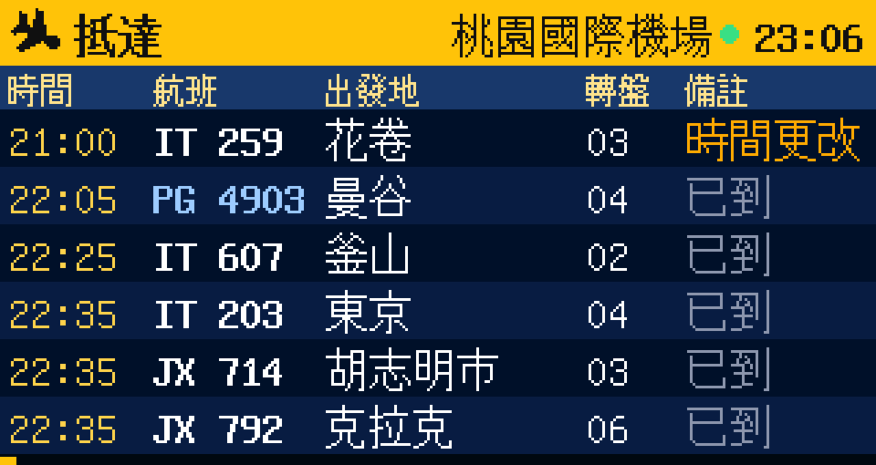

# tiny-fids — 機場航班看板 FIDS for LilyGO T-Display S3 Touch



在 T-Display S3 Touch（320×170）上顯示**桃園機場（TPE）**與**松山機場（TSA）**的即時出發／抵達航班，介面仿照機場大螢幕：琥珀色標題列、深藍底、中英文交替顯示、共用班號輪播、翻頁動畫。

## 資料來源（官方開放資料，不需要 API 金鑰）
| 機場 | 網址 | 格式 |
|---|---|---|
| 桃園 | `taoyuan-airport.com/uploads/flightx/a_flight_v4.txt` | Big5 CSV（兩航廈、出發＋抵達） |
| 松山 | `tsa.gov.tw/api/publicDataArea/GetFormaterData?id=…`（4 個） | JSON（國際/國內 × 出發/抵達） |

每 3 分鐘更新一次，在背景工作（core 0）下載，畫面不會卡住。

## 操作
| 操作 | 功能 |
|---|---|
| **BOOT 鍵**（GPIO0）短按 | 切換機場 桃園 ⇄ 松山 |
| **BOOT 鍵** 長按 | 調整亮度（4 段） |
| **KEY 鍵**（GPIO14）短按 | 下一頁 |
| **KEY 鍵** 長按 | 切換 出發 ⇄ 抵達 |
| 觸控 上／下滑 | 翻頁 |
| 觸控 左／右滑 | 切換機場 |
| 點標題列 | 切換 出發 ⇄ 抵達 |
| 點一班航班 | 詳細資訊（登機門、櫃台、轉盤、機型、共用班號），再點一下或按任一鍵返回 |
| 長按螢幕 | 立即更新資料 |

看板每 8 秒自動翻頁（輪播前 5 頁），手動操作後暫停 30 秒。標題列時鐘旁的燈號：綠＝正常、藍閃＝更新中、紅＝更新失敗或資料過舊。
機場、方向、亮度會記住，重開機後保留。

## 燒錄
```bash
pio run -t upload        # 或用 VS Code 的 PlatformIO
pio device monitor
```
第一次開機會開啟 Wi-Fi 設定熱點 **FIDS-Setup**，用手機連上後在網頁中選擇家裡的 Wi-Fi。也可以直接在 `src/config.h` 填入 `WIFI_SSID` / `WIFI_PASS`。

畫面上下顛倒的話，把 `src/config.h` 的 `SCREEN_ROTATION` 改成 `1`。

## 在電腦上預覽介面
`sim/build.sh` 會下載最新資料，用同一份 UI 與解析程式碼在 Mac/Linux 上渲染出截圖（需要 SDL2：`brew install sdl2`）：
```bash
sim/build.sh               # 截圖輸出到 sim/out/
sim/build.sh sim/out 1792571400   # 指定模擬時間（epoch，此例為 2026-10-21 16:30）
```

## 檔案
- `src/main.cpp` — 按鍵、觸控手勢、Wi-Fi、主迴圈
- `src/ui.cpp` — FIDS 看板與詳細頁繪製
- `src/parser.cpp` — 桃園 CSV（Big5）與松山 JSON 解析、共用班號合併
- `src/fetcher.cpp` — HTTPS 下載與背景更新
- `src/lgfx_tdisplay_s3.h` — 螢幕／觸控腳位設定
- `tools/gen_big5.py` — 產生 Big5→Unicode 對照表 `src/big5_table.h`

## 3D 列印外殼
倒 T 字形的機場看板外殼（前框＋卡扣背蓋＋看板面板＋底座），免螺絲、免支撐。
STL 在 [`enclosure/makerworld/stl/`](enclosure/makerworld/stl/)，設計說明與組裝方式見 [`enclosure/README.md`](enclosure/README.md)。
外殼由 Fusion 360 API 腳本產生（`enclosure/build_enclosure.py`、`enclosure/build_block.py`），板子尺寸參考 LilyGO 官方 3D 模型。

## 授權
[MIT](LICENSE)。航班資料來自桃園國際機場、臺北松山機場的公開資料，版權屬於原提供單位。
