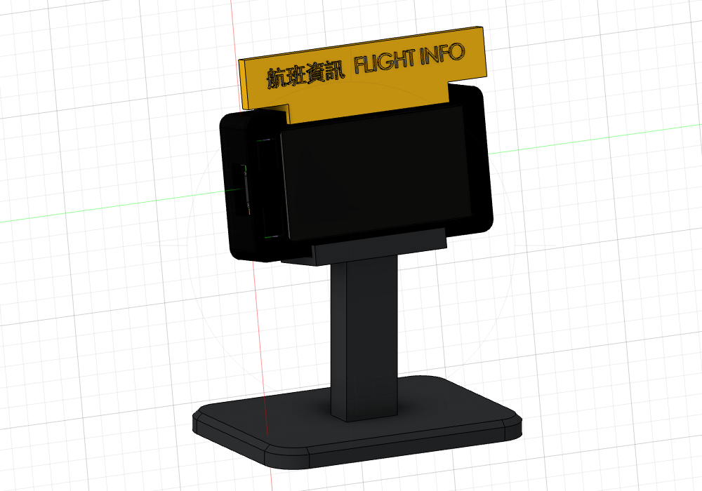

# 機場看板外殼（T-Display S3 **Touch**）

| 檔案 | 零件 | 建議列印方向 | 顏色 |
|---|---|---|---|
| `stl/1_front_shell.stl` | 前框（螢幕框＋按鍵彈片） | 正面朝下（已是此方向） | 黑／深灰 |
| `stl/2_back_cover.stl` | 背蓋（卡扣、散熱孔） | 翻面，外側平面朝下 | 黑／深灰 |
| `stl/3_stand.stl` | 立柱底座（後仰 10°） | 底座朝下（已是此方向） | 深灰 |
| `stl/5_panel.stl` | 黑色看板面板（100×60×20，前框整組從正面嵌入） | 正面朝下（已是此方向） | 黑 |
| `stl/6_base.stl` | 倒 T 底座（110×70×8，面板插進中間的槽） | 底面朝下 | 黑 |
| `stl/4_topper_sign.stl` | 頂部招牌「航班資訊 FLIGHT INFO」 | 側立（短邊朝下），不用支撐 | 黃色，字可塗黑 |

0.2 mm 層高、PLA 即可，全部不需要支撐。

## 組裝
1. 前框正面朝下，板子螢幕朝下從背面放進去：32×55 的玻璃外框邊從內側靠在前框唇邊上，27×50 的玻璃面從開口露出來。
2. 蓋上背蓋，壓到兩側四個卡鉤「喀」一聲扣進側壁的小方孔。背蓋內側的橫樑凸點從後面撐住電路板。要拆時，用牙籤從側面方孔把卡鉤往內推，再從遠離 USB 那端的缺口撬開。
3. 把螢幕下緣插進立柱的托架，再把招牌套在上緣。外殼上下對稱，螢幕方向 (rotation 1/3) 哪一邊朝上都能裝。

4. 倒 T 看板版：面板下緣插進底座的槽；USB 端朝左（rotation 3），把組好的前框從面板正面壓進嵌槽，靠背面擋邊定位；要拆時從面板背面把前框往前推出。USB 線從面板左側孔插入。面板與底座由 `build_block.py` 產生。

## 功能開孔
- **BOOT / KEY 按鍵**：前框 USB 那側上下兩個圓形凹點，按下去由彈片頂到按鍵
- **USB-C**：側面開口 12.6 × 7.2 mm
- **RST**：上下兩側各有一個 Ø2 小孔，用迴紋針按
- **背蓋散熱孔**：5 條

## 尺寸來源與注意事項
- 板子：LilyGO 官方 `t-display-s3-full.stp`
- 觸控玻璃：官方 `CapacitiveTouchScreen.stp`（32×55 外框邊＋27×50 凸起玻璃，總厚 1.4），並用社群 Touch 外殼的玻璃槽尺寸交叉確認
- 外形 35.6 × 65.8 × 14.6 mm；含立柱與招牌約 70 × 50 × 95 mm

**列印前建議用卡尺確認你的板子**：玻璃寬 27 / 外框邊 32 mm，玻璃正面到背面最高零件約 11.3 mm。
不一致的話，改 `build_enclosure.py` 開頭的參數，在 Fusion 360 重跑即可（`fusion_helpers.py` 是共用函式）。
原始 Fusion 檔：`fids_enclosure.f3d`；STEP：`fids_enclosure.step`
