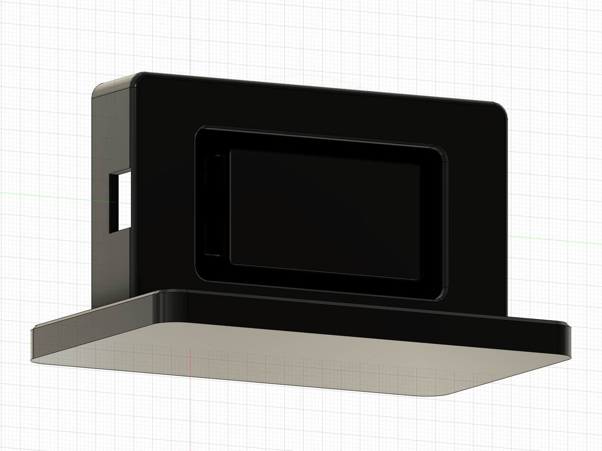

# Enclosure / 外殼 — LilyGO T-Display S3 **Touch**

**English** | [中文](#中文)

## Parts
Ready-to-print STLs, already in print orientation, are in [`stl/`](stl/):

| File | Part | Orientation |
|---|---|---|
| `1_front_shell.stl` | Front shell (screen bezel and flexure buttons) | Face down |
| `2_back_cover.stl` | Back cover (4 snap hooks, spring beams, vents) | Outer face down, hooks up |
| `3_panel.stl` | Display panel, 100×60×20 mm | Face down |
| `4_base.stl` | Inverted-T base, 110×70×8 mm | Bottom down |

PLA at 0.2 mm layer height works. No supports needed. The ledge on the back of the panel has a small 1.5 mm overhang that most printers handle fine. Black filament is recommended.

## Assembly
1. Place the front shell face down. Insert the board screen-first from the back. The 32×55 mm glass frame rests against the inner lip, and the 27×50 mm glass shows through the opening.
2. Press the back cover in until all four hooks click into the small windows in the side walls. The spring beams on the inside hold the PCB in place. To open it, push the hooks inward through the side windows with a toothpick, then pry the cover out at the notch on the end away from USB.
3. Slide the bottom edge of the panel into the slot in the base.
4. Route the USB cable through the hole on the left of the panel and plug it in. Press the shell module into the panel from the front with the USB end on the left (`SCREEN_ROTATION 3`). To remove the module, push it out from the back of the panel.

## Openings
- **BOOT / KEY buttons**: two round dimples on the USB end of the front shell. Pressing one flexes a tab whose plunger presses the button.
- **USB-C**: 12.6 × 7.2 mm opening on the side
- **RST**: Ø2 mm pinholes on the top and bottom edges (use a paperclip)
- **Back cover vents**: 5 slots

## Notes
- Board dimensions come from LilyGO's official `t-display-s3-full.stp`. Touch-glass dimensions come from the official `CapacitiveTouchScreen.stp`. These reference files are not included in this repo.
- Board thickness can vary slightly between batches. If the buttons don't register, build up the plunger tips a little. If a button stays pressed, sand the tips down.

---

## 中文

[English](#parts) | **中文**

### 零件
可直接列印的 STL（已轉成列印方向）在 [`stl/`](stl/)：

| 檔案 | 零件 | 列印方向 |
|---|---|---|
| `1_front_shell.stl` | 前框（螢幕框＋按鍵彈片） | 正面朝下 |
| `2_back_cover.stl` | 背蓋（4 個卡鉤、彈片、散熱孔） | 外側平面朝下，卡鉤朝上 |
| `3_panel.stl` | 看板面板 100×60×20 mm | 正面朝下 |
| `4_base.stl` | 倒 T 底座 110×70×8 mm | 底面朝下 |

PLA、0.2 mm 層高即可，全部不需要支撐。面板背面擋邊有約 1.5 mm 的小懸空，一般印表機都印得好。建議用黑色線材。

### 組裝
1. 前框正面朝下，板子螢幕朝下，從背面放進去。32×55 mm 的玻璃外框邊會從內側靠在前框唇邊上，27×50 mm 的玻璃從開口露出來。
2. 壓上背蓋，壓到四個卡鉤「喀」一聲扣進側壁的小方孔。背蓋內側的彈片會從後面撐住電路板。要拆時，用牙籤從側面方孔把卡鉤往內推，再從遠離 USB 那端的缺口撬開。
3. 面板下緣插進底座的槽。
4. USB 線從面板左側的孔穿入並接上板子，再把前框模組 USB 端朝左（`SCREEN_ROTATION 3`），從正面壓進面板。要拆時從面板背面往前推出來。

### 功能開孔
- **BOOT / KEY 按鍵**：前框 USB 那端的兩個圓形凹點。按下去時，彈片上的頂柱會頂到按鍵。
- **USB-C**：側面開口 12.6 × 7.2 mm
- **RST**：上下兩側各有一個 Ø2 小孔，用迴紋針按
- **背蓋散熱孔**：5 條

### 注意事項
- 板子尺寸參考 LilyGO 官方的 `t-display-s3-full.stp`，觸控玻璃參考官方的 `CapacitiveTouchScreen.stp`。這些參考檔沒有放在這個 repo 裡。
- 不同批次的板子厚度可能略有差異。按鍵按不到的話，把頂柱尖端墊高一點；一直按住的話，把尖端磨短一點。
